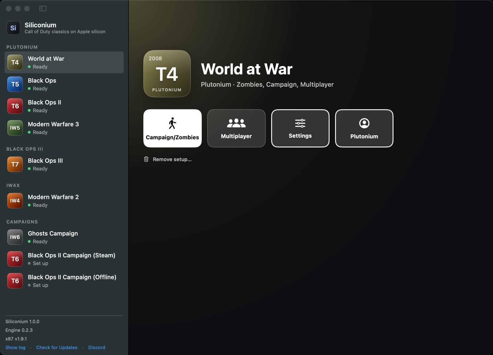
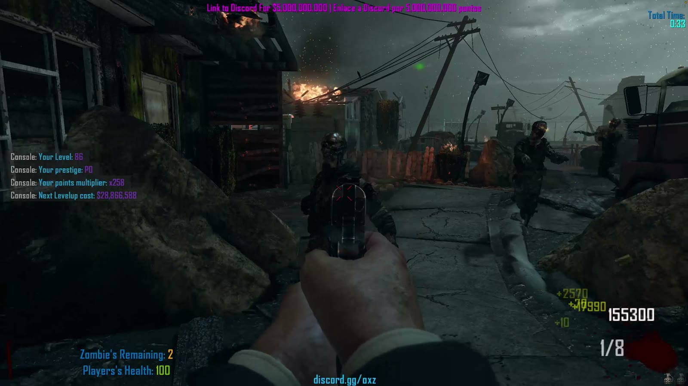

<p align="center">
  
</p>

<h1 align="center">Siliconium</h1>

<p align="center">
  <b>The classic Call of Duty games on Apple silicon, in one app.</b><br>
  World at War · Black Ops · Black Ops II · Black Ops III · Modern Warfare 2 · Modern Warfare 3 · Ghosts
</p>

<p align="center">
  <a href="https://github.com/sirdankdabs/siliconium/releases/latest"><b>Download</b></a> ·
  <a href="#getting-started">Getting started</a> ·
  <a href="#faq">FAQ</a> ·
  <a href="https://discord.gg/4hpEXFqvNR">Discord</a> ·
  <a href="CHANGELOG.md">Changelog</a>
</p>

---

Choose your game folder, press **Install**, press **Play**. Siliconium brings its own engine, built from open source, with patches tuned for Apple GPUs and Rosetta. You don't need CrossOver, a Wine install or Terminal.

<p align="center">
  <a href="docs/assets/showcase.mp4"></a><br>
  <a href="docs/assets/showcase.mp4"><b>▶ Watch the showcase</b></a> (1 min, all gameplay recorded on a MacBook Pro M1 Pro)
</p>

<p align="center">
  
</p>

<p align="center">
  
  
  
</p>

## Games

| | Game | Client | Modes | On an M1 Pro, 2560×1440 |
|---|---|---|---|---|
| **T4** | World at War | Plutonium | Zombies, Campaign, Multiplayer | 104–136 FPS |
| **T5** | Black Ops | Plutonium | Zombies, Campaign, Multiplayer | 131–154 FPS |
| **T6** | Black Ops II | Plutonium | Zombies, Multiplayer | 160 FPS |
| **T6** | Black Ops II Campaign | Steam or offline | Campaign | 160 FPS |
| **T7** | Black Ops III | Ezz (BOIII) | Zombies, Campaign, Multiplayer | 120+ FPS on high settings |
| **IW4** | Modern Warfare 2 | IW4X | Multiplayer | 158–160 FPS |
| **IW5** | Modern Warfare 3 | Plutonium | Multiplayer | 138–156 FPS |
| **IW6** | Ghosts | Offline | Campaign | 140-160 FPS |

Measured in game with the display at 160 Hz. Your numbers depend on your Mac and settings.

> **Optional: Black Ops III for Mac.** Siliconium can also run the Mac version of Black Ops III from Steam on the community servers (BO3 Mac Client with BO3MacFix). It is hidden by default because Ezz is the recommended way to play. Turn it on in **View → Show Black Ops III for Mac (Steam)**.

## Highlights

- **Fast and steady.** Direct3D 9 runs on DXVK + MoltenVK and Direct3D 11 on DXMT. Shaders compile in the background and are kept between sessions. The games run on the performance cores, and x87 maths is accelerated by [x87sidecar](https://github.com/athei/x87sidecar).
- **Fullscreen done right.** Every game opens at your display's resolution and true refresh rate, in a native 1x mode, so a HiDPI desktop doesn't cost frames.
- **Controllers.** Xbox, PlayStation (DualShock 4, DualSense, DualSense Edge), Switch Pro, Joy-Con and 8BitDo, wired or Bluetooth. Optional console-style aim assist.
- **No surprises.** "Set Optimal Settings?" and "Safe Mode" prompts never undo your settings. Intro movies are skipped.
- **Ready the first time.** *Prepare all maps* compiles every map's shaders once, so even a first visit loads complete.
- **Keeps itself up to date:** the app, Plutonium, IW4X, boiii and the x87 accelerator.

## Getting started

**You need**
- A Mac with Apple silicon and Rosetta 2.
- macOS 15 Sequoia or later. macOS 14 runs the Direct3D 9 games only (World at War, Black Ops, MW2, MW3).
- Your own copies of the games. For online play, a free [Plutonium](https://plutonium.pw) account.

**Install**
1. Download `Siliconium.dmg` from [Releases](https://github.com/sirdankdabs/siliconium/releases/latest), open it and drag **Siliconium** to Applications. The first time, right-click it and choose **Open**, or allow it in System Settings → Privacy & Security → **Open Anyway**.
2. Pick a game, press **Install** for the engine, then **Choose…** your game folder.
3. Press **Play**.

Plutonium games ask you to sign in once; Siliconium downloads Plutonium for you. For Black Ops III (Windows), Siliconium downloads boiii and opens Ezz's launcher. Pick **Beta** there.

### Game folders

| Game | The folder needs |
|---|---|
| World at War, Black Ops, Black Ops II | `zone/` (and `main/`) |
| Modern Warfare 3 | the **32-bit** game: `main/` (with `iw_00.iwd`…), `zone/`, `mss32.dll` |
| Modern Warfare 2 | `main/`, `zone/`, `iw4x-launcher.exe` |
| Ghosts | `iw6sp64_ship.exe`, `zone/prologue.ff`, `bink2w64.dll`, `steam_api64.dll` |
| Black Ops III (Windows) | `BlackOps3.exe` and `zone/` |

## FAQ

**A map looks incomplete the first time I play it.**
Its shaders are still compiling; every later visit is instant. Run **Settings → Shaders → Prepare all maps** once to compile them all ahead of time.

**My Bluetooth controller doesn't work.**
macOS asks for **Input Monitoring** the first time. Allow Siliconium in System Settings → Privacy & Security → Input Monitoring, then start the game again. Wired controllers and USB dongles don't need it.

**macOS says a file "could not be verified".**
Open Siliconium once more and start the game again. The app clears the download quarantine from its engine. Never choose "Move to Trash".

**Where are my files?**
In `~/Library/Application Support/Siliconium`: the engine, the Wine prefixes, Plutonium and the shader caches. Your game folders are never modified, except for the settings each game keeps there.

**I used BO-Mac before.**
Siliconium is its new name. Your installation moves over on its own the first time the app opens.

## Building from source

```bash
./build-app.sh
```
Builds `dist/Siliconium.app` (Xcode command line tools, macOS 14 SDK or later). The engine itself is built with [`engine/build-engine.sh`](engine/build-engine.sh). The patches applied on top of Wine, DXVK and DXMT are in [`kit/patches`](kit/patches), and engineering notes with measurements are in [`docs/OPTIMIZATION-NOTES.md`](docs/OPTIMIZATION-NOTES.md).

```
app/      the macOS app (SwiftUI)
kit/      launch and setup scripts, patches and payload, shipped inside the app
engine/   how the Wine engine is built and packed
bo3/      BO3 Mac Client and BO3MacFix sources (optional Black Ops III for Mac)
```

## Credits

- **Plutonium**: the World at War, Black Ops, Black Ops II and Modern Warfare 3 clients.
- **IW4X**: the Modern Warfare 2 client (GPL-3.0).
- **Ezz / BOIII**: [boiii-free](https://github.com/Ezz-lol/boiii-free), built on momo5502's BOIII.
- **The Wine project**, **CodeWeavers** (open-source CrossOver Wine) and **WineHQ** (Wine Mono, Wine Gecko).
- **Sikarugir** (Gcenx and contributors): the engine's x86_64 libraries.
- **athei**: [x87sidecar](https://github.com/athei/x87sidecar). **Lifeisawful**: [rosettax87](https://github.com/Lifeisawful/rosettax87).
- **DXVK** (Philip Rebohle and contributors), **Sporif** (dxvk-async), **3Shain**: [DXMT](https://github.com/3Shain/dxmt). **Khronos**: MoltenVK.
- **BO3MacFix** by Emma / InvoxiPlayGames and Anthony / serious, with **T7Patch** work by its authors.
- **atom0s**: [Steamless](https://github.com/atom0s/Steamless) (CC BY-NC-ND 4.0).
- **Logo-2K**: [Zombies Declassified](https://github.com/Logo-2K/zombies-declassified).
- **GStreamer** contributors.
- **kopyl** and **cothromachd**, for testing and reports.

## Legal

Siliconium does not include game files, Steam or any Steam API replacement; you need your own copies of the games. Removing DRM may be restricted by law where you live (for example the DMCA or the EU InfoSoc Directive), so use the offline campaign tools only where that is allowed.

Not affiliated with Activision, Treyarch, Infinity Ward, Aspyr, Valve, CodeWeavers, Plutonium, IW4X or Ezz. Call of Duty, Black Ops and Modern Warfare are trademarks of Activision Publishing, Inc.

## License

The app and scripts are MIT ([LICENSE](LICENSE)). The patches follow the licenses of what they patch (Wine: LGPL-2.1+, DXVK: zlib, DXMT: its license). Downloaded and included components keep their own licenses.
