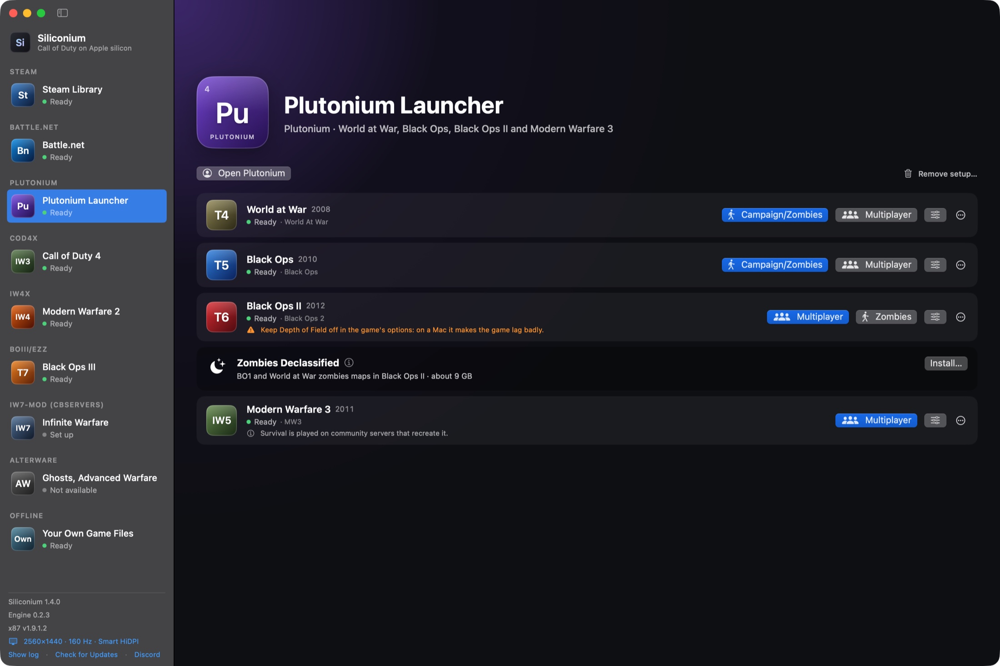
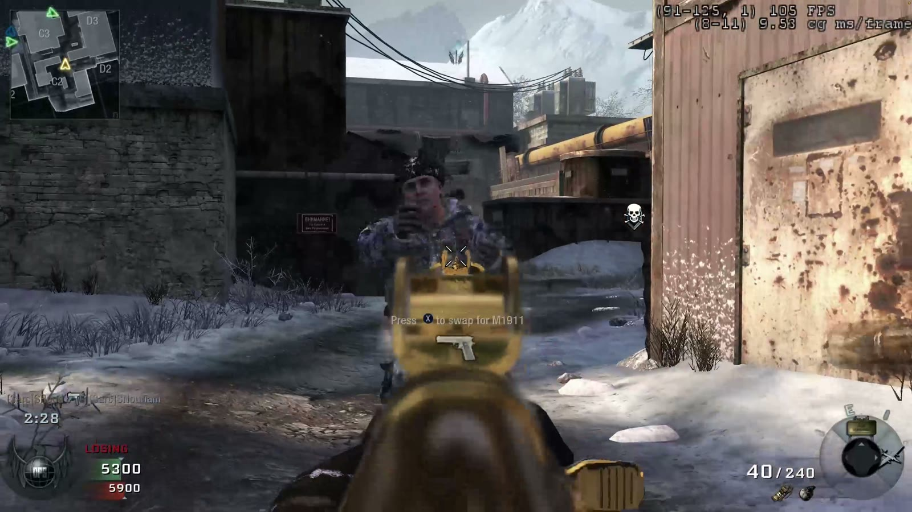

<p align="center">
  
</p>

<h1 align="center">Siliconium</h1>

<p align="center">
  <b>Call of Duty on Apple silicon, in one app.</b><br>
  Call of Duty · United Offensive · Call of Duty 2 · Call of Duty 4 · World at War · Modern Warfare 2 · Black Ops · Modern Warfare 3 · Black Ops II · Ghosts · Advanced Warfare · Black Ops III · Infinite Warfare · WWII · Black Ops 4<br>
  (Plutonium, BOIII/Ezz, IW4X, CoD4X, IW7-Mod and Project-BO4 included)
</p>

<p align="center">
  <a href="https://github.com/sirdankdabs/siliconium/releases/latest"><b>Download</b></a> ·
  <a href="#games">Games</a> ·
  <a href="#getting-started">Getting started</a> ·
  <a href="#faq">FAQ</a> ·
  <a href="https://discord.gg/4hpEXFqvNR">Discord</a> ·
  <a href="CHANGELOG.md">Changelog</a>
</p>

---

Download your games in the **Steam Library** or **Battle.net**, or choose your own game folders for **Plutonium**, **IW4X**, **CoD4X**, **BOIII**, or **Offline campaigns**, then press **Play**. Siliconium brings its own open-source engine tuned for Apple silicon — native Metal translation for Direct3D 9 (`mtld3d`) and Direct3D 11 (`DXMT`), SIMD-accelerated 32-bit audio, and Rosetta x87 acceleration. You don't need CrossOver, a Wine install or Terminal.

<p align="center">
  <a href="docs/assets/showcase.mp4"></a><br>
  <a href="docs/assets/showcase.mp4"><b>▶ Watch the showcase</b></a> (1 min, all gameplay recorded on a MacBook Pro M1 Pro)
</p>

<p align="center">
  <a href="docs/assets/plutonium-launcher.jpg"></a><br>
  Siliconium 1.4.0: unified Plutonium Launcher, Steam Library, Battle.net, community clients and offline campaigns in one app
</p>

<p align="center">
  
  
  
</p>

## Games

There are four ways to play. The **Steam Library** plays Steam's own files with Siliconium's setup, and the **Battle.net** section does the same for the games sold only on Battle.net (Black Ops 4, also offline with Project-BO4's **Shield**). The **community clients** (**Plutonium Launcher**, IW4X, CoD4X, BOIII, IW7-Mod) play your game folders or your Steam downloads, and **Offline → Your Own Game Files** plays your own CoD 4, MW2, MW3, Black Ops II (with **T6SP-Mod**), and Ghosts campaign folders directly without Steam (with automatic folder linking to Plutonium, IW4X, and CoD4X). The **AlterWare** section explains why AlterWare's Ghosts and Advanced Warfare clients cannot be played on Apple silicon.

FPS numbers come from a MacBook Pro M1 Pro (macOS 15+ / Apple silicon) at 2560×1440, in game, with the display at 160 Hz. A range is the lowest and highest the FPS counter showed during play; "avg" is the average over a play session. Your numbers depend on your Mac and settings. Test conditions and what is verified for each game: [COMPATIBILITY.md](COMPATIBILITY.md).

### Steam Library

| Game | Campaign | Multiplayer | Zombies |
|---|---|---|---|
| **Call of Duty** (2003) | Works (player confirmed)<br>**148 FPS** avg, median 157 | Not tested<br>not measured yet | – |
| **Call of Duty: United Offensive** (2004) | Works (player confirmed)<br>**122 FPS** avg, median 118 | Not tested<br>not measured yet | – |
| **Call of Duty 2** (2005) | Works (player confirmed)<br>**133–160 FPS** | Not re-tested since the fixes<br>not measured yet | – |
| **Call of Duty 4: Modern Warfare** (2007) | Works (`mtld3d`)<br>**158–160 FPS** | Not tested<br>(CoD4X: see below) | – |
| **World at War** (2008) | Runs (`mtld3d`)<br>not measured yet | Not tested<br>not measured yet | Runs (`mtld3d`)<br>**143–160 FPS** |
| **Modern Warfare 2** (2009) | Works (player confirmed)<br>**160 FPS** flat (`mtld3d` 32-bit) / 151–160 (64-bit) | Runs<br>menus ~90 FPS; not measured in a match yet | – |
| **Black Ops** (2010) | Works (`mtld3d`)<br>**145–160 FPS** | Accepted by the player<br>**~91 FPS** (the game's own cap online) | Works (`mtld3d`)<br>**152–160 FPS** |
| **Modern Warfare 3** (2011) | Works<br>**115–160 FPS** (first mission), Survival 150 | Blocked: stays at "Connecting to online services" | – |
| **Black Ops II** (2012) | Works (`T6SP-Mod`)<br>**158–160 FPS** | Not tested<br>not measured yet | Works<br>**158–160 FPS** |
| **Ghosts** (2013) | Runs (player)<br>**150–154 FPS** (borderless) | Not tested<br>not measured yet | – |
| **Advanced Warfare** (2014) | Playable<br>**108 FPS** avg (first mission, unified DXMT) | Blocked: stays at "Connecting to online services" | Exo Zombies: blocked, as Multiplayer |
| **Black Ops III** (2015) | Runs<br>shared with BOIII | Runs (Clean Ops)<br>shared with BOIII | Works<br>**71–81 FPS** (80% scale) / **62 FPS** native 1440p |
| **Infinite Warfare** (2016) | Playable<br>**~50–58 FPS** at the game's own settings (GPU-bound) | Not tested<br>not measured yet | Not tested in Steam's game<br>(IW7-Mod: see below) |
| **WWII** (2017) | Playable<br>**74–78 FPS** (first mission, GPU-bound) | Runs<br>**~60–70 FPS** | Runs (`+18%` tuned)<br>**70 FPS** avg (**−62%** p99 spikes) |

Call of Duty's official timedemo runs at 138–139 FPS. Black Ops III has one **Play** button: Campaign, Multiplayer and Zombies are chosen in its own menu; its **Fixes** menu offers **Clean Ops**, the community Multiplayer patch (also in the Mod Tools' map tests). Its **Mod Tools** button downloads Treyarch's Black Ops III Mod Tools from Steam: the launcher, Radiant, compiling, lighting and linking work, in a workspace that never changes Steam's files (your maps and mods are linked from `Documents/Black Ops III Mod Tools`).

### Battle.net

| Game | Multiplayer | Zombies | Blackout |
|---|---|---|---|
| **Black Ops 4** (2018) | Not tested yet | Plays (player)<br>**~62 FPS** at 75% / 1080p render scale (Blood of the Dead, GPU-bound); also offline with **Shield** | Not tested yet |

### Community clients and offline

| | Game | Client | Modes | Status | FPS |
|---|---|---|---|---|---|
| **T4** | World at War | Plutonium | Zombies, Campaign, Multiplayer | Works (`mtld3d`) | Zombies **143–160** (Der Riese), Multiplayer ~136 |
| **T5** | Black Ops | Plutonium | Zombies, Campaign, Multiplayer | Works (`mtld3d`) | Zombies **152–160** (Kino / Call of the Dead), Multiplayer ~131 |
| **T6** | Black Ops II | Plutonium | Zombies, Multiplayer | Works (`DXMT`) | Zombies **158–160** (Nuketown / Town) |
| **IW5** | Modern Warfare 3 | Plutonium | Multiplayer | Works (`mtld3d`) | **148–160** (Dome) |
| **IW3** | Call of Duty 4 | CoD4X | Multiplayer | Works (`mtld3d`) | **144–160** (Crash) |
| **IW4** | Modern Warfare 2 | IW4X | Multiplayer | Works (`mtld3d`) | **155–160** (Rust) |
| **T7** | Black Ops III | Ezz (BOIII) | Zombies, Campaign, Multiplayer | Works (`DXMT`) | **71–81** (80% scale, crisp native UI) / **62** native 1440p; **120+** at lighter settings |
| **IW7** | Infinite Warfare | IW7-Mod (CBServers) | Zombies, Campaign, Multiplayer, custom maps | Zombies works (`DXMT`) | Zombies **55–70** at High settings |
| **OF** | CoD 4, MW2, MW3, BO2, Ghosts | Your Own Game Files | Offline Campaigns | Works | **150–160** (`IW3SP-MOD`, `IW-Pad v0.1.3`, `T6SP-Mod` included) |

**New in 1.4.0**
- **Native Direct3D 9 → Metal (`mtld3d v0.15.5`)** for 32-bit CoD 4, CoD4X, WaW, BO1, MW2/IW4X, and MW3: locked **150–160 FPS** (up to **+45%** faster on WaW Zombies and CoD4X, with *Call of the Dead* frost shaders fixed).
- **Custom SSE2 + SIMD 32-bit audio (`dsound.dll`)**: **7.1× faster** audio mixing (**−86%** audio CPU under load; **14× less** audio-thread CPU in MW2).
- **23% smaller app (`144 MB → 111 MB`)**: unified tessellation-fixed DXMT (`winemetal.so`) across all Direct3D 11 titles and removed duplicate payloads.
- **Unified Plutonium Launcher & Offline *Your Own Game Files*** (CoD 4, MW2, MW3, BO2 with default **T6SP-Mod**, Ghosts, plus **IW-Pad v0.1.3** 32/64-bit), live MB/s + ETA download progress, Smart HiDPI, pre-warmed Wine startup (~4 s faster), and fullscreen screenshot/recording support (`Cmd+Shift+3/4/5`) without minimizing.
- **Apple Silicon D3D11 tuning**: WWII **+18% FPS** / **−62%** p99 spikes / **−280 MB RAM**; BO3 **+10–30% FPS** / **−570 MB RAM**; BO4 **−230 MB RAM** and smooth first-start scaling.

**New in 1.3.0**
- **Battle.net** section with **Black Ops 4**: Siliconium installs Battle.net for Windows, you sign in and install the game there, and **Play** starts it with Siliconium's setup.
- **Call of Duty: WWII** in the Steam Library (campaign, Multiplayer, Nazi Zombies), and a **BO3 Mod Tools** button for Black Ops III.
- **macOS Game Mode in every game**, the game comes to the front by itself when it starts, and it is back within about a second after Cmd-Tab.
- Optional fixes: **Shield (Project-BO4)** for Black Ops 4 (offline, without Battle.net's online services) and **Clean Ops** for Black Ops III (also in the Mod Tools' map tests).
- Your Mac keeps its HiDPI display mode while you play (no mode switch at start, at the end or after Cmd-Tab).

**New in 1.2.0**
- **Call of Duty: Infinite Warfare** in the Steam Library, and the **IW7-Mod (CBServers)** section: CBServers' community client with its servers and custom maps, from your Steam download (Steam's files are never changed) or your own folder.
- Steam's Call of Duty 4, Modern Warfare 2 and Modern Warfare 3 and CoD4X start again (they did not start in 1.1.0 and 1.1.1 with controller mapping on).

**New in 1.1.1**
- **Call of Duty: United Offensive** in the Steam Library (campaign and multiplayer), with Call of Duty's setup. It installs into Call of Duty's folder, as on Windows, so Steam needs Call of Duty in the same account.
- Call of Duty and United Offensive draw trees, lit models and distant fog as with OpenGL (tree leaves were missing).

**New in 1.1.0**
- **Steam Library:** play the Steam versions from Steam's own files, with Siliconium's setup: fullscreen at your display's size and refresh rate, controller support (also for the games without it on PC), shader caches, and an optional **Fixes** menu for some games (IW3SP-MOD, T4Me, IW-Pad, T6SP-Mod, Clean Ops).
- **CoD4X:** Call of Duty 4 multiplayer through the CoD4X client, also from your Steam download (Steam's files are never changed).

All changes: [CHANGELOG.md](CHANGELOG.md).

> **Optional: Black Ops III for Mac.** Siliconium can also run the Mac version of Black Ops III from Steam on the community servers (BO3 Mac Client with BO3MacFix). It is hidden by default because Ezz is the recommended way to play. Turn it on in **View → Show Black Ops III for Mac (Steam)**.

## Highlights

- **Native Metal performance.** 32-bit Direct3D 9 games translate straight to Metal via [`mtld3d`](https://github.com/athei/mtld3d) (with DXVK + MoltenVK kept for CoD 2 and 64-bit Steam MW2/MW3), Direct3D 11 runs on unified tessellation-fixed [`DXMT`](https://github.com/3Shain/dxmt), and Call of Duty / United Offensive draw through Siliconium's own GLDirect build. 32-bit audio uses a custom SSE2+SIMD Wine `dsound.dll`, x87 maths runs on [`x87sidecar`](https://github.com/athei/x87sidecar), and a pre-warmed Wine engine cuts startup time by ~4 s.
- **Fullscreen & Smart HiDPI done right.** Games open at your display's resolution and true refresh rate. Smart HiDPI keeps sharp HiDPI active on `mtld3d` and BO2 with zero display mode switch, while heavy D3D11 titles hold an optimal 1x mode on scaled desktops. Every game runs in macOS Game Mode, comes to the front by itself, supports macOS screenshots/recording (`Cmd+Shift+3/4/5`) without minimizing, and returns within ~1 s after Cmd-Tab.
- **Controllers.** Xbox, PlayStation (DualShock 4, DualSense, DualSense Edge), Switch Pro, Joy-Con and 8BitDo, wired or Bluetooth, including full controller mapping for PC titles that never shipped gamepad support plus **IW-Pad v0.1.3** (32-bit & 64-bit) and optional console-style aim assist.
- **No surprises.** "Set Optimal Settings?" and "Safe Mode" prompts never undo your settings. Intro movies are skipped. Live MB/s download speed and ETA appear across every launcher setup.
- **Ready the first time.** Local shader caching and cross-seeding across sibling D3D9 installs, plus *Prepare all maps* to precompile every map once.
- **Keeps itself up to date:** the app, Plutonium, IW4X, CoD4X, boiii, engine modules and the x87 accelerator.

## Getting started

**You need**
- A Mac with Apple silicon and Rosetta 2.
- macOS 15 Sequoia or later. macOS 14 runs the Direct3D 9 games of Plutonium and IW4X only (World at War, Black Ops, MW2, MW3); the Steam Library and CoD4X were tested on macOS 15 only.
- Your own copies of the games. For the Steam Library, a Steam account that owns them. For online play on Plutonium, a free [Plutonium](https://plutonium.pw) account.

**Install**
1. Download `Siliconium.dmg` from [Releases](https://github.com/sirdankdabs/siliconium/releases/latest), open it and drag **Siliconium** to Applications. The first time, right-click it and choose **Open**, or allow it in System Settings → Privacy & Security → **Open Anyway**.
2. Pick a game, press **Install** for the engine, then **Choose…** your game folder.
3. Press **Play**.

**Steam Library:** press **Install** for the engine and **Install Steam** (Steam for Windows, in its own prefix), then sign in to Steam and tick *Remember me*. Download your games in Steam (**Open Steam**, or **Download all**); each one then gets a button for every part (**Campaign**, **Multiplayer**, **Zombies**).

**Battle.net:** press **Install** for the engine and **Install Battle.net** (Battle.net for Windows, in its own prefix), then sign in to Battle.net and tick *Keep me logged in*. **Install** opens the game's page in Battle.net to download it there; then press **Play**. To play Black Ops 4 offline, choose **Shield (Project-BO4)** in its **Fixes** menu (Battle.net must have started the game once).

Plutonium games ask you to sign in once; Siliconium downloads Plutonium for you. CoD4X installs from its official releases without any installer windows. For Black Ops III (Windows), Siliconium downloads boiii and opens Ezz's launcher. Pick **Beta** there.

### Game folders

| Game | The folder needs |
|---|---|
| World at War, Black Ops, Black Ops II | `zone/` (and `main/`) |
| Modern Warfare 3 | the **32-bit** game: `main/` (with `iw_00.iwd`…), `zone/`, `mss32.dll` |
| Modern Warfare 2 | `main/`, `zone/`, `iw4x-launcher.exe` |
| Call of Duty 4 (CoD4X) | `iw3mp.exe`, `main/`, `zone/` |
| Infinite Warfare (IW7-Mod, CBServers) | `iw7_ship.exe`, `common.ff`, `main/` |
| Ghosts | `iw6sp64_ship.exe`, `zone/prologue.ff`, `bink2w64.dll`, `steam_api64.dll` |
| Black Ops III (Windows) | `BlackOps3.exe` and `zone/` |

The Steam Library needs no folder: it plays the games where Steam downloaded them. IW4X, CoD4X, BOIII and IW7-Mod use your Steam download of Modern Warfare 2, Call of Duty 4, Black Ops III and Infinite Warfare when their tab has no folder; **Settings → Change…** picks another.

## FAQ

**A map looks incomplete the first time I play it.**
Its shaders are still compiling; every later visit is instant. Run **Settings → Shaders → Prepare all maps** once to compile them all ahead of time.

**My Bluetooth controller doesn't work.**
macOS asks for **Input Monitoring** the first time. Allow Siliconium in System Settings → Privacy & Security → Input Monitoring, then start the game again. Wired controllers and USB dongles don't need it.

**macOS says a file "could not be verified".**
Open Siliconium once more and start the game again. The app clears the download quarantine from its engine. Never choose "Move to Trash".

**CoD4X asks for a key code.**
It asks once for the Call of Duty 4 key. Steam shows it under **Manage → CD Keys**.

**Where are my files?**
In `~/Library/Application Support/Siliconium`: the engine, the Wine prefixes (Steam's and Battle.net's too), Plutonium and the shader caches. Your game folders are never modified, except for the settings each game keeps there. A fix chosen in a Steam game's **Fixes** menu puts its files in the game's folder only while that part runs. IW4X's launcher adds its own files next to the game's, and CoD4X and IW7-Mod play Steam's Call of Duty 4 and Infinite Warfare from their own copy (APFS clones made at each start: no extra disk space, and between games the copy keeps only the client's own files). Siliconium keeps no installers once it is set up, and its game logs keep only their newest part.

**I used BO-Mac before.**
Siliconium is its new name. Your installation moves over on its own the first time the app opens.

## Building from source

```bash
./build-app.sh
```
Builds `dist/Siliconium.app` (Xcode command line tools, macOS 14 SDK or later). The engine itself is built with [`engine/build-engine.sh`](engine/build-engine.sh). The patches applied on top of Wine, DXVK and DXMT are in [`kit/patches`](kit/patches), and engineering notes with measurements are in [`docs/OPTIMIZATION-NOTES.md`](docs/OPTIMIZATION-NOTES.md).

```
app/      the macOS app (SwiftUI)
kit/      launch and setup scripts, patches and payload, shipped inside the app
engine/   how the Wine engine is built and packed
bo3/      BO3 Mac Client and BO3MacFix sources (optional Black Ops III for Mac)
```

## Credits

- **Plutonium**: the World at War, Black Ops, Black Ops II and Modern Warfare 3 clients.
- **IW4X**: the Modern Warfare 2 client (GPL-3.0).
- **CoD4X team**: the [CoD4X](https://cod4x.ovh) Call of Duty 4 client.
- **Ezz / BOIII**: [boiii-free](https://github.com/Ezz-lol/boiii-free), built on momo5502's BOIII.
- **CBServers**: [IW7-Mod (CBServers)](https://github.com/CBServers/iw7-mod), their fork of **AuroraMod**'s [IW7-Mod](https://github.com/auroramod/iw7-mod) Infinite Warfare client (GPL-3.0), downloaded from CBServers' official link.
- Optional fixes, downloaded from their authors and never shipped: **JerryALT** ([IW3SP-MOD](https://gitea.com/JerryALT/iw3sp_mod)), **JBShady** ([T4M Enhanced](https://github.com/JBShady/T4M-Enhanced)), **GalvarinoDev** ([IW-Pad](https://github.com/GalvarinoDev/IW-Pad)), **Rattpak** ([T6SP-Mod](https://github.com/Rattpak/T6SP-Mod-Release)), **nxghtwolf** ([Clean Ops](https://cleanops.dev)), **project-bo4** ([Shield](https://github.com/project-bo4/shield-development); Build R2 by **Scroptss**).
- **The Wine project**, **CodeWeavers** (open-source CrossOver Wine) and **WineHQ** (Wine Mono, Wine Gecko).
- **Sikarugir** (Gcenx and contributors): the engine's x86_64 libraries.
- **athei**: [mtld3d](https://github.com/athei/mtld3d) (native Direct3D 9 → Metal) and [x87sidecar](https://github.com/athei/x87sidecar). **Lifeisawful**: [rosettax87](https://github.com/Lifeisawful/rosettax87).
- **DXVK** (Philip Rebohle and contributors), **Sporif** (dxvk-async), **3Shain**: [DXMT](https://github.com/3Shain/dxmt). **Khronos**: MoltenVK.
- **SciTech Software** (GLDirect, original author Keith Harrison), **MrRendroc** ([GLDirect 5](https://github.com/MrRendroc/gldirect)) and **Brian Paul** (Mesa 6.0): Call of Duty's OpenGL on Direct3D 9 (MIT; notices in `kit/payload/steam/cod1-gl/LICENSE.txt`).
- **BO3MacFix** by Emma / InvoxiPlayGames and Anthony / serious, with **T7Patch** work by its authors.
- **Logo-2K**: [Zombies Declassified](https://github.com/Logo-2K/zombies-declassified).
- **GStreamer** contributors.
- **kopyl** and **cothromachd**, for testing and reports.

## Legal

Siliconium does not include game files, Steam or any Steam API replacement; you need your own copies of the games.

Not affiliated with Activision, Blizzard, Treyarch, Infinity Ward, Sledgehammer Games, Gray Matter Interactive, Aspyr, Valve, CodeWeavers, Plutonium, IW4X, CoD4X or Ezz. Call of Duty, Black Ops and Modern Warfare are trademarks of Activision Publishing, Inc.

## License

The app and scripts are MIT ([LICENSE](LICENSE)). The patches follow the licenses of what they patch (Wine: LGPL-2.1+, mtld3d: MIT, DXVK: zlib, DXMT: its license). Downloaded and included components keep their own licenses.
