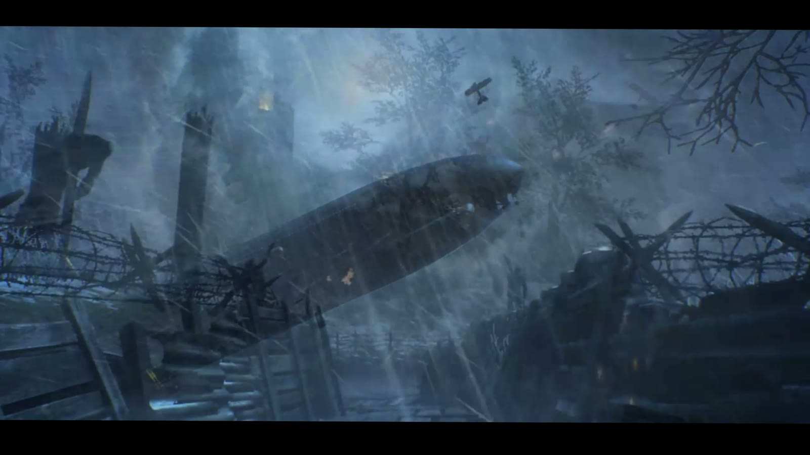
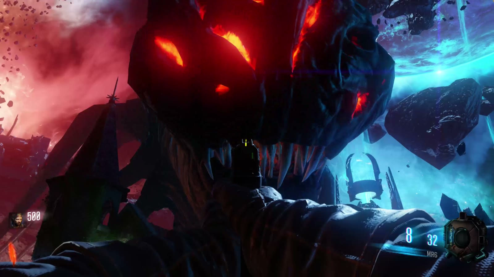
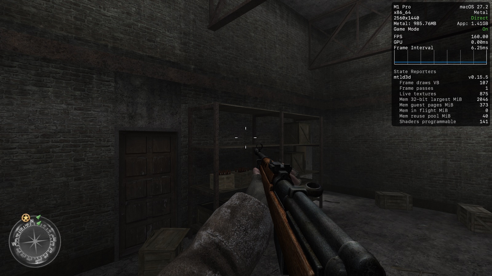
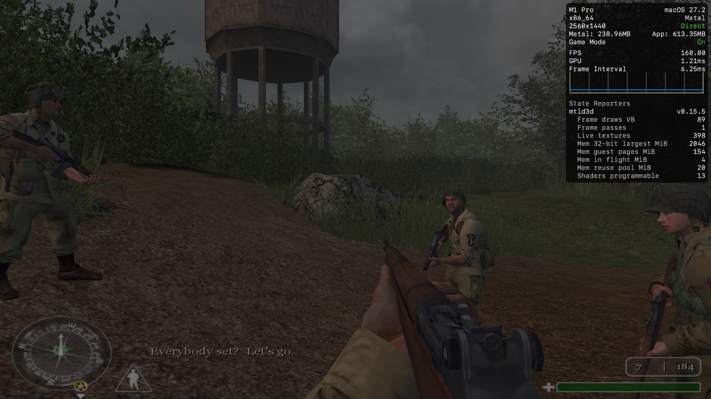
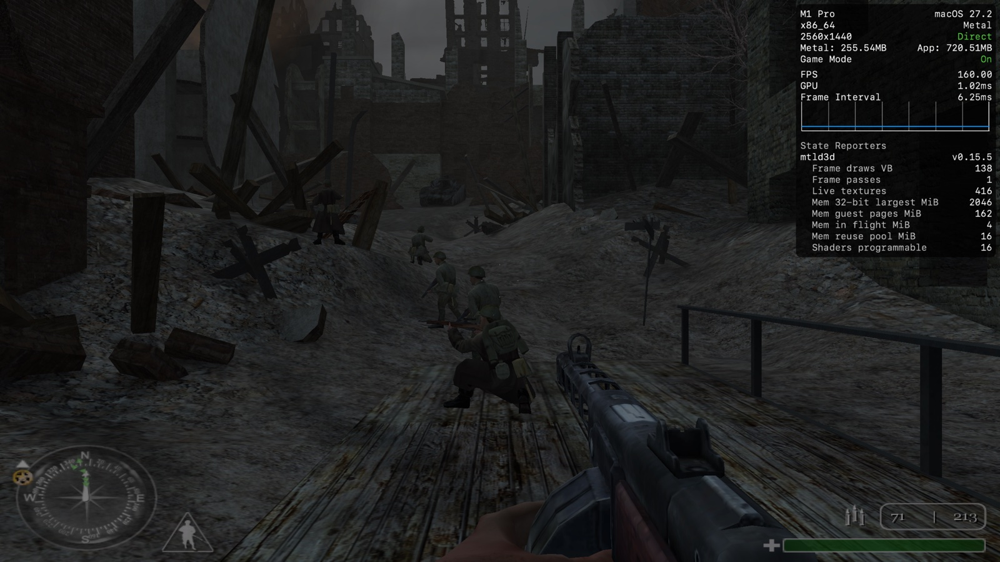

<p align="center">
  
</p>

<h1 align="center">Siliconium</h1>

<p align="center">
  <b>15 Call of Duty games on Apple silicon: native Metal performance, one app, zero Terminal.</b><br>
  Steam Library · Battle.net · Plutonium · IW4X · CoD4X · BOIII (Ezz) · IW7-Mod · Project-BO4 · Offline Campaigns
</p>

<p align="center">
  <a href="https://github.com/sirdankdabs/siliconium/releases/latest"><b>Download</b></a> ·
  <a href="#supported-games">Games</a> ·
  <a href="#why-siliconium">Highlights</a> ·
  <a href="#quick-start">Quick Start</a> ·
  <a href="#faq">FAQ</a> ·
  <a href="https://discord.gg/4hpEXFqvNR">Discord</a> ·
  <a href="CHANGELOG.md">Changelog</a>
</p>

---

**Siliconium** is a self-contained macOS app (`~111 MB`) with its own open-source engine built specifically for Call of Duty on Apple silicon. Sign in to **Steam** or **Battle.net**, or point it at your own game folders for **Plutonium**, **IW4X**, **CoD4X**, **BOIII**, **IW7-Mod**, or **Offline campaigns**, then press **Play**. No CrossOver, no Wine setup, no config editing.

<p align="center">
  <a href="docs/assets/showcase.mp4"></a><br>
  <a href="docs/assets/showcase.mp4"><b>▶ Watch the 1-minute showcase</b></a> (recorded on a MacBook Pro M1 Pro)
</p>

<p align="center">
  <a href="docs/assets/plutonium-launcher.jpg"></a>
</p>

<p align="center">
  
  
  
</p>

<p align="center">
  
  
  
</p>

## Why Siliconium

- **Direct-to-Metal graphics:** all classic 32-bit Direct3D 9 Call of Duty titles — including CoD 2 and CoD 1 / United Offensive (via patched GLDirect) — translate straight to Metal via [`mtld3d`](https://github.com/athei/mtld3d) (**150–160 FPS** at 1440p), and Direct3D 11 runs on unified tessellation-fixed [`DXMT`](https://github.com/3Shain/dxmt).
- **Built for Apple silicon:** native ARM x87 acceleration ([`x87sidecar`](https://github.com/athei/x87sidecar)), custom **SSE2 + SIMD 32-bit audio** (`dsound.dll`, **7.1× faster** mixing), pre-warmed Wine launches (~4 s faster), and automatic shader caching.
- **Native macOS polish:** **macOS Game Mode** on every title, **Smart HiDPI** (zero mode switch on `mtld3d` & BO2), true monitor refresh rates, instant `Cmd+Tab`, fullscreen screenshots/recording (`Cmd+Shift+3/4/5`), and live download speed + ETA.
- **Plug-and-play controllers:** Xbox, DualSense, DualShock 4, Switch Pro, Joy-Con and 8BitDo (wired or Bluetooth), with built-in gamepad mapping for older PC titles, console aim assist, and one-click community fixes (**IW-Pad v0.1.3**, **IW3SP-MOD**, **T6SP-Mod**, **T4Me**, **Clean Ops**, **Shield**).
- **Hands-off & self-updating:** keeps the app, engine, Plutonium, IW4X, CoD4X, BOIII and `x87sidecar` up to date automatically, and never alters your Steam game files.

## Supported Games

Measured on a **MacBook Pro M1 Pro** (macOS 15+, **2560×1440 @ 160 Hz**). Full per-mode test details: [COMPATIBILITY.md](COMPATIBILITY.md) · Known issues: [KNOWN_ISSUES.md](KNOWN_ISSUES.md).

| Game | Sources & Clients | Performance (1440p) | Notes |
|---|---|---|---|
| **Call of Duty** (2003) | Steam Library | **159–160 FPS** (`GLDirect → mtld3d`) | Custom GLDirect → Metal renderer |
| **United Offensive** (2004) | Steam Library | **Up to 160 FPS** (`GLDirect → mtld3d`) | Installs into CoD 1 folder via Steam |
| **Call of Duty 2** (2005) | Steam Library | **160 FPS** (`mtld3d`, up to 307 uncapped) | Fullscreen & controller support |
| **Call of Duty 4** (2007) | Steam · **CoD4X** · Offline | **144–160 FPS** (`mtld3d`) | Optional **IW3SP-MOD** for Campaign |
| **World at War** (2008) | **Plutonium (T4)** · Steam | **143–160 FPS** (`mtld3d`) | Optional **T4Me** for Steam SP/ZM |
| **Modern Warfare 2** (2009) | **IW4X** · Steam · Offline | **155–160 FPS** (`mtld3d`) | **IW-Pad v0.1.3** (32 & 64-bit) |
| **Black Ops** (2010) | **Plutonium (T5)** · Steam | **145–160 FPS** (`mtld3d`) | ~91 FPS Steam MP (game cap) |
| **Modern Warfare 3** (2011) | **Plutonium (IW5)** · Steam · Offline | **148–160 FPS** (`mtld3d`) | Plutonium requires 32-bit files; **IW-Pad** |
| **Black Ops II** (2012) | **Plutonium (T6)** · Steam · Offline | **158–160 FPS** (`DXMT`) | **T6SP-Mod** & **Zombies Declassified** built in |
| **Ghosts** (2013) | Steam · Offline | **150–154 FPS** (`DXMT`) | Campaign only (AlterWare blocked by Rosetta 2) |
| **Advanced Warfare** (2014) | Steam Library | **108 FPS** avg (`DXMT`) | Campaign playable; online MP/Exo blocked |
| **Black Ops III** (2015) | **Ezz (BOIII)** · Steam · Mod Tools | **71–81 FPS** (80% scale) | **Clean Ops** & full **BO3 Mod Tools** supported |
| **Infinite Warfare** (2016) | **IW7-Mod (CBServers)** · Steam | **55–70 FPS** (`DXMT`) | Custom maps supported via `usermaps/` |
| **WWII** (2017) | Steam Library | **70–78 FPS** (`DXMT`) | Campaign, Multiplayer & Nazi Zombies |
| **Black Ops 4** (2018) | **Battle.net** · **Shield (Project-BO4)** | **~62 FPS** (1080p scale) | Offline Zombies/MP/Blackout via **Shield** |

> **Black Ops III for Mac (Steam):** also supported via BO3 Mac Client + BO3MacFix (hidden by default in favor of Ezz / BOIII). Enable under **View → Show Black Ops III for Mac (Steam)**.

## Quick Start

**Requirements:** Apple silicon Mac (M1 or newer) · **macOS 15 Sequoia+** · Rosetta 2 · your own copies of the games (plus a free [Plutonium](https://plutonium.pw) account for Plutonium online play).

1. Download **`Siliconium.dmg`** from [Releases](https://github.com/sirdankdabs/siliconium/releases/latest) and drag **Siliconium** to **Applications**. *(First launch: right-click → **Open**, or allow in System Settings → Privacy & Security.)*
2. Open Siliconium and click **Install** to download the engine.
3. Choose how you want to play:
   - **Steam Library / Battle.net:** click **Install Steam** or **Install Battle.net**, sign in (*Remember me*), download your games, and press **Play**.
   - **Plutonium / IW4X / CoD4X / BOIII / IW7-Mod / Offline:** pick your game folder (or let Siliconium auto-link your Steam or offline folders) and press **Play**.

<details>
<summary><b>Expected folder contents for manual / offline setups</b></summary>

| Game / Client | Required inside folder |
|---|---|
| World at War, Black Ops, Black Ops II | `zone/` (and `main/`) |
| Modern Warfare 3 (Plutonium IW5) | **32-bit** copy: `main/` (`iw_00.iwd`…), `zone/`, `mss32.dll` |
| Modern Warfare 2 (IW4X) | `main/`, `zone/` *(Siliconium fetches `iw4x-launcher.exe`)* |
| Call of Duty 4 (CoD4X) | `iw3mp.exe`, `main/`, `zone/` |
| Infinite Warfare (IW7-Mod) | `iw7_ship.exe`, `common.ff`, `main/` |
| Ghosts (Offline) | `iw6sp64_ship.exe`, `zone/prologue.ff`, `bink2w64.dll`, `steam_api64.dll` |
| Black Ops III (BOIII / Ezz) | `BlackOps3.exe`, `zone/` *(pick **Beta** in Ezz's launcher)* |

Steam downloads are automatically detected by IW4X, CoD4X, BOIII and IW7-Mod without touching Steam's files (CoD4X and IW7-Mod run from zero-extra-space APFS clones).

</details>

## FAQ

<details>
<summary><b>Bluetooth controller isn't detected</b></summary>
Allow Siliconium in <b>System Settings → Privacy & Security → Input Monitoring</b>, then restart the game. Wired controllers and USB dongles work immediately.
</details>

<details>
<summary><b>A map hitches or looks incomplete the first time</b></summary>
Shaders are compiling on first visit; every later visit is instant. You can also run <b>Settings → Shaders → Prepare all maps</b> once ahead of time.
</details>

<details>
<summary><b>macOS says a file "could not be verified"</b></summary>
Never choose "Move to Trash". Reopen Siliconium and launch the game again: the app clears the download quarantine automatically.
</details>

<details>
<summary><b>Streaming a game window in Discord or OBS</b></summary>
Share your screen (<b>Screens</b>), or disable <b>Settings → Hide fullscreen game on Cmd+Tab</b> so the game window stays visible in Discord's <b>Applications</b> picker.
</details>

<details>
<summary><b>CoD4X asks for a key code / Where are Siliconium's files stored?</b></summary>
CoD4X asks once for your CoD 4 key (in Steam: <b>Manage → CD Keys</b>). All Siliconium data (engine, Wine prefixes, Plutonium, shader caches, capped logs) lives in <code>~/Library/Application Support/Siliconium</code>. Your game folders stay untouched.
</details>

## Building from Source

Requires Xcode Command Line Tools (macOS 14+ SDK):

```bash
./build-app.sh
```

Builds `dist/Siliconium.app`. Engine build scripts live in [`engine/`](engine/), patches in [`kit/patches/`](kit/patches/), and technical deep dives in [`ARCHITECTURE.md`](ARCHITECTURE.md) and [`docs/OPTIMIZATION-NOTES.md`](docs/OPTIMIZATION-NOTES.md).

<details>
<summary><b>Credits & Third-Party Components</b></summary>

- **Clients:** **Plutonium**, **IW4X** (GPL-3.0), **CoD4X** ([cod4x.ovh](https://cod4x.ovh)), **Ezz / BOIII** ([boiii-free](https://github.com/Ezz-lol/boiii-free), built on momo5502's BOIII), **CBServers** ([IW7-Mod](https://github.com/CBServers/iw7-mod), fork of AuroraMod's IW7-Mod, GPL-3.0).
- **Optional fixes** *(downloaded on demand from authors, never shipped)*: **JerryALT** ([IW3SP-MOD](https://gitea.com/JerryALT/iw3sp_mod)), **JBShady** ([T4M Enhanced](https://github.com/JBShady/T4M-Enhanced)), **GalvarinoDev** ([IW-Pad](https://github.com/GalvarinoDev/IW-Pad)), **Rattpak** ([T6SP-Mod](https://github.com/Rattpak/T6SP-Mod-Release)), **nxghtwolf** ([Clean Ops](https://cleanops.dev)), **project-bo4** ([Shield](https://github.com/project-bo4/shield-development); Build R2 by **Scroptss**), **Logo-2K** ([Zombies Declassified](https://github.com/Logo-2K/zombies-declassified)).
- **Graphics, Wine & Emulation:** **athei** ([mtld3d](https://github.com/athei/mtld3d), [x87sidecar](https://github.com/athei/x87sidecar)), **Lifeisawful** ([rosettax87](https://github.com/Lifeisawful/rosettax87)), **3Shain** ([DXMT](https://github.com/3Shain/dxmt)), **DXVK** (Philip Rebohle & contributors), **Sporif** (dxvk-async), **Khronos** (MoltenVK), **The Wine Project**, **CodeWeavers** (open-source CrossOver Wine), **WineHQ** (Mono, Gecko), **Sikarugir** (Gcenx & contributors), **GStreamer**, **SciTech Software / MrRendroc / Brian Paul** (GLDirect 5 / Mesa 6.0, MIT).
- **BO3 Mac & Testing:** **Emma / InvoxiPlayGames** and **Anthony / serious** (BO3MacFix), **T7Patch** authors, **kopyl**, **cothromachd**, and **Andytizer**.

</details>

## Legal & License

Siliconium ships **no game files, Steam, or Steam API replacements**; you must own the games you play. Not affiliated with Activision, Blizzard, Treyarch, Infinity Ward, Sledgehammer Games, Aspyr, Valve, CodeWeavers, Plutonium, IW4X, CoD4X, or Ezz. All trademarks belong to their respective owners.

App and scripts are **MIT** ([LICENSE](LICENSE)). Patches follow their upstream licenses (Wine: LGPL-2.1+, mtld3d: Zlib, DXVK: zlib, DXMT: upstream license).
